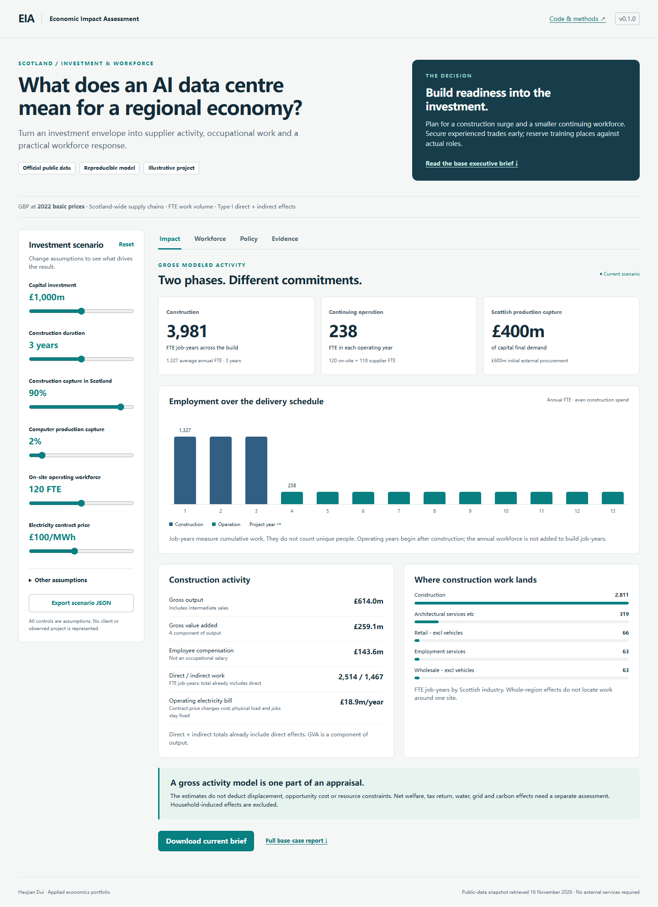

# Economic Impact Assessment

**An investment committee case: how should Scotland prepare suppliers and workers for an AI data centre?**

This independent portfolio project by Haojian Dui turns official input-output accounts, occupational staffing and training data into a reproducible investment and workforce assessment. The investment itself is a labeled scenario, with no client engagement or observed project outcome claimed.

[Interactive dashboard](https://joedhj.github.io/economic-impact-assessment/) · [Executive brief](outputs/executive-brief.md) · [Full economic impact report](outputs/economic-impact-report.md) · [Latest release](https://github.com/JoeDHJ/economic-impact-assessment/releases/latest)

## What the completed case finds

| Measure | Base scenario result | Meaning |
| --- | --- | --- |
| Capital investment | £1,000m in 2022 basic prices | Assumed envelope; £400m buys Scottish production |
| Construction work | 3,981 FTE job-years | 1,327 annual average FTE over three years; not unique or permanent jobs |
| Construction GVA | £259.1m | Part of £614.0m gross output; not a net welfare benefit |
| Annual operating work | 238 FTE | 120 assumed on-site FTE + 118 modeled Scottish supplier FTE |
| Physical electricity | 189.2 GWh/year | 20 MW IT × 90% load × PUE 1.2; a scenario, not grid approval |
| Workforce response | Sequence training and recruitment | The assumed 48-month electrical cohort misses a 36-month launch |

Actual Scottish records show 659 Electrical Installation and 74 HVAC/refrigeration apprenticeship achievements in 2025/26. Those trainees are generally already employed; they are not an available labor pool. UK 2025 occupational staffing shares proxy Scottish FTE composition. The [supply assessment](docs/policy-and-supply.md) sets out what further evidence is needed before quantifying a shortage.

Changing construction capture from 90% to 70% reduces modeled construction work from 3,981 to 3,206 FTE job-years. Extending the build from two to four years halves annual average demand while leaving cumulative work unchanged. These are conditional scenario comparisons, not forecasts or confidence intervals. A contract electricity price increase changes the bill, while physical generation and modeled real employment stay fixed.



## Reproduce the case

Python 3.11+; no API keys, proprietary multipliers or running sibling apps.

```sh
python -m venv .venv
# Windows: .venv\Scripts\activate
# macOS/Linux: source .venv/bin/activate
python -m pip install -e ".[dev]"
impact-assessment validate
impact-assessment run --output outputs
impact-assessment build-site --output site
impact-assessment serve --directory site --port 8765
```

Open `http://127.0.0.1:8765` yourself, or open the built `site/index.html` offline. The dashboard contains the data locally and makes no network requests. It exports the current scenario JSON, occupational CSV and Markdown brief; static reports are labeled as the base case. No Word/PDF output is generated.

```sh
# Edit a complete scenario, then rerun it
impact-assessment scenario --output my-scenario.json
impact-assessment run --scenario my-scenario.json --output my-results
# Rebuild coefficients from the included original official files
python scripts/prepare_data.py
# Check pinned downloads, preserving existing files
impact-assessment refresh --destination data/public/sources
python -m pytest -q
python scripts/browser_check.py --channel msedge  # installed Edge on Windows
# On Linux CI: python -m playwright install --with-deps chromium
# Then: python scripts/browser_check.py
```

The numerical package can also be installed from the wheel attached to a release with only NumPy as a runtime dependency. Data rebuilding adds pandas/openpyxl; development and browser checks use the optional `dev` dependencies.

## Inspect the work

| Deliverable | Where to look |
| --- | --- |
| Management conclusion and evidence | [Executive brief](outputs/executive-brief.md), [full report](outputs/economic-impact-report.md) |
| Industry, occupation, skill, policy and timing estimates | [Industries](outputs/industries.csv), [occupations](outputs/occupations.csv), [occupation/skill links](outputs/occupation_skills.csv), [sensitivities](outputs/sensitivities.csv), [policy options](outputs/policy_options.csv), [schedule](outputs/schedule.csv) |
| Actual public data and provenance | [Source inventory](data/source-manifest.json), [original source files](data/public/sources), [processed industry data](data/processed/industries.csv), [skills reference](data/processed/skills-reference.csv) |
| Model and economic interpretation | [Methodology](docs/methodology.md), [core calculation](src/impact_assessment/model.py), [scenario schema](docs/scenario-inputs.md) |
| Workforce policy and management communication | [Supply and policy assessment](docs/policy-and-supply.md), [presentation outline](docs/presentation-outline.md), [two-minute demo](docs/demo-script.md) |
| Employer relevance and quality assurance | [Actual employer JD matrix](docs/employer-evidence.md), [validation and independent review](docs/validation.md), [implementation status](docs/implementation-status.md) |

## Evidence and boundaries

The 98-industry **Scottish Government 2022 domestic IxI table** already excludes imports from the rest of the UK and world. The package reconstructs its technical coefficients and reconciles the inverse and employment effects with the publisher's tables. A hand-solvable model guards orientation and double counting. Construction and operations, job-years and annual FTE, gross output and GVA, production capture and commuting are separate quantities.

Operations are procurement-led: on-site staffing is added once to supplier activity; the centre's revenue and own GVA are not imputed. The Type I model excludes household-induced effects. Gross modeled activity does not establish additional jobs, net welfare or tax/subsidy returns. Actual provider spare capacity, site-level applicants, competing projects and a counterfactual appraisal are not observed here.

Public sources: [Scottish IO](https://www.gov.scot/publications/input-output-latest/), [Skills England occupational staffing](https://explore-education-statistics.service.gov.uk/find-statistics/occupations-in-demand/2025/explore), [SDS apprenticeship totals](https://www.skillsdevelopmentscotland.co.uk/media/josfrdus/modern-apprenticeship-supplementary-tables-quarter-4-2025-26.xlsx), [Scottish Employer Skills Survey](https://www.gov.scot/publications/employer-skills-survey-2024-scotland/pages/skill-shortage-vacancies/). Retrieval: 16 November 2026. Data attribution and licenses are in [data/README.md](data/README.md).

## Portfolio

The [portfolio.v1 interface](docs/portfolio-interface.md) preserves source, taxonomy and scenario status. The project remains independently runnable. Related work: [AI Labor Atlas](https://github.com/JoeDHJ/ai-labor-atlas), [Corporate AI Adoption](https://github.com/JoeDHJ/corporate-ai-adoption), [Career Fit](https://github.com/JoeDHJ/career-fit).
