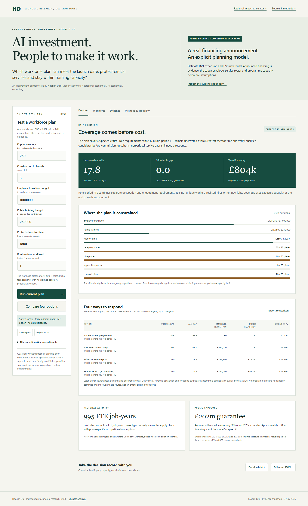

# AI Investment & Workforce Assessment

**Which workforce plan can meet an AI infrastructure launch date, protect critical services and stay within delivery capacity?**

An independent economic-analysis work sample by **Haojian Dui**, focused on labour markets, personnel economics, AI economics and economic consulting. Version 0.2.0 connects primary project disclosures and official local observations to phased occupational demand, task-based service coverage and a working constrained workforce-allocation model. No client mandate, realised employer outcome or causal AI/training effect is claimed.

[Open the decision workspace](https://joedhj.github.io/economic-impact-assessment/) · [Decision brief](outputs/workforce/workforce-decision-brief.md) · [Methods](docs/workforce-methodology.md) · [Capability & interview guide](docs/capability-and-interview.md) · [Latest release](https://github.com/JoeDHJ/economic-impact-assessment/releases/latest)



## A real case, explicit assumptions

The [DataVita disclosure](https://blog.datavita.co.uk/blog/datavita-secures-funding-data-centre-expansion) covers DV1 expansion and DV3 new-build in North Lanarkshire. Approximately £300m financing and £202m guarantee exposure are disclosed facts; they are not a bill of capex or immediate public spending. Approximately 600 construction jobs and 100 permanent roles are announcements with an unspecified FTE/duration basis, not verified outcomes. DV2 and the wider growth-zone jobs headline are different scopes.

The planning model uses an **independent £250m capital assumption at 2022 basic prices**, a three-year build, 98 Scottish IO industries and 412 UK SOC2020 staffing proxies. An assumed technical service roster produces **85.58 operating service FTE** from tasks and productive hours. Construction programme targets are a scenario share of selected Scottish occupational peaks, not the site's entire workforce or a measured local shortage.

The [claim ledger](data/public/evidence/project-claim-ledger.json) preserves source, scope, date and status. [39 official North Lanarkshire observations](data/public/evidence/local-labour-observations.csv) distinguish resident employment, workplace jobs and nominal pay; suppressed values stay missing. Employment stocks and apprenticeship achievements are not available candidates or spare provider seats.

## What the allocation actually finds

Three successive integer optimisations protect critical-role capacity, then minimise all deficits, then minimise programme resource present cost at those coverage levels. Constraints cover qualified pathway eligibility, lead times, route/role places, employer/public transition budgets and mentor hours. Expected attrition is checked through the engagement end, not just launch or year one.

| Conditional option | Critical gap | All-role gap | Employer transition | Public transition | Programme resource PV |
| --- | ---: | ---: | ---: | ---: | ---: |
| No capacity commissioned through the routes | 78.65 | 99.92 | £0 | £0 | £0 |
| Hire and contract only | 20.84 | 42.11 | £524,000 | £0 | £8.432m |
| Mixed programme | 0.00 | 17.83 | £725,250 | £78,750 | £12.868m |
| Launch after four years | 0.00 | 14.80 | £764,050 | £87,750 | £12.921m |

Gaps are **role-period FTE**, combining separate occupation/engagement capacity targets; do not sum them as unique people or new jobs. The later-launch case changes peak targets and the coverage denominator. Its missing delay/revenue/escalation costs prevent an investment-value ranking. Transition budgets exclude ongoing pay/contract fees, which are included in the separate resource-PV ledger and need funding. The no-programme comparator does not assert an empty existing workforce.

The useful decision is where to act. Default redeployment, hiring and contractor caps are exhausted; mentor time is 1,650 of 1,800 hours. [Declared constraint experiments](outputs/workforce/constraint-sensitivities.csv) show that increasing employer budget alone to £1.5m, or mentor time alone to 3,000h, leaves the 17.83 gap unchanged. Jointly assuming 60 redeployment places, 100 hiring places and 3,000 mentor hours covers the expected targets, using £999,500 employer transition funding, £135,000 public funding and 2,600 mentor hours. These are requirements to verify, not evidence that those candidates exist.

Regional gross activity, employer costs and public programme cost-effectiveness remain separate. The guarantee stress has uncalibrated PD/LGD; actual expected fiscal cost, social NPV and benefit-cost ratio are unavailable. Expected qualified capacity is not operational safety clearance.

## Use and reproduce

Python 3.11+; no API keys, proprietary multipliers, backend service or sibling applications.

```sh
python -m venv .venv
# Windows: .venv\Scripts\activate
# macOS/Linux: source .venv/bin/activate
python -m pip install -e ".[dev]"
impact-assessment validate
impact-assessment workforce --output outputs/workforce
impact-assessment build-site --output site
impact-assessment serve --directory site --port 8765
```

Open `http://127.0.0.1:8765` yourself. The browser runs a bundled HiGHS WebAssembly solver locally in a worker. It needs HTTP for interactive optimisation, with no external network calls or uploads. Published results and the [original regional calculator](https://joedhj.github.io/economic-impact-assessment/impact.html) remain readable via a local file URL. Edit the six main controls or the complete advanced JSON; import/save assumptions; solve one plan or compare four options; export the current brief, full result, allocations, gaps, monthly occupations and retention coverage. Changed inputs disable result downloads until solved. Single-plan results label the default comparison separately.

```sh
impact-assessment workspace --output my-workforce.json
# Edit the complete assumptions, then:
impact-assessment workforce --scenario my-workforce.json --output my-results
# Original £1bn regional benchmark, preserved:
impact-assessment run --output outputs
# Rebuild pinned public tables and packaged documentation:
python scripts/prepare_data.py
python scripts/prepare_project_evidence.py
python scripts/prepare_workforce_inputs.py
python scripts/prepare_documentation.py
python scripts/assess_constraints.py
python -m pytest -q
python scripts/browser_check.py --channel msedge
python scripts/workforce_browser_check.py --channel msedge
# Linux: install Chromium first and omit --channel msedge
python -m playwright install --with-deps chromium
```

Runtime dependencies are NumPy and SciPy. Optional development dependencies support data preparation and browser checks. Release wheels include the data, browser solver/licenses and method notes; building a site outside the checkout is supported. Original official source files and the frozen Nomis factual table snapshot allow offline rebuilding. Refresh commands are explicit, never silent. No Word or PDF files are generated.

## Inspect the professional evidence

| Question | Inspectable work |
| --- | --- |
| Can the analysis distinguish observations from assumptions? | [Project claims and local facts](data/public/evidence), [original source manifest](data/source-manifest.json) |
| Does the economic model preserve units and scope? | [Workforce methods](docs/workforce-methodology.md), [original IO methodology](docs/methodology.md), [monthly delivery](outputs/workforce/monthly-delivery.csv) |
| Does the personnel plan handle real constraints? | [Allocation model](src/impact_assessment/workforce.py), [selected cohorts](outputs/workforce/programme-allocations.csv), [retention coverage](outputs/workforce/retention-coverage.csv) |
| Can a decision maker use and challenge it? | [Live workspace](https://joedhj.github.io/economic-impact-assessment/), [current default brief](outputs/workforce/workforce-decision-brief.md), editable input/result exports |
| Can the author explain it in an interview? | [Four-direction capability map and demo](docs/capability-and-interview.md), [owner rehearsal](docs/owner-rehearsal.md), [official consulting-role evidence](docs/employer-evidence.md) |
| Is the computation and presentation checked? | [Validation](docs/validation.md), [v0.2 review record](docs/v0.2-review-record.md), automated tests, browser parity and clean-wheel verification |

For research-intensive roles, combine this planning case with an independently identified empirical paper. Its contribution is economic measurement, constrained decision support and transparent communication; causal estimation, client fieldwork and realised impact remain separate evidence.

## Preserved benchmark and attribution

The original £1bn scenario gives 3,981 construction FTE job-years, £259.1m GVA within £614m gross output, and 238 annual operating FTE (120 assumed on-site plus 118 supplier FTE). It remains available through the original CLI and calculator. The new workspace uses its own £250m scenario and keeps task service capacity separate from IO supplier jobs to avoid double counting.

Official sources include [Scottish IO](https://www.gov.scot/publications/input-output-latest/), [Skills England staffing](https://explore-education-statistics.service.gov.uk/find-statistics/occupations-in-demand/2025/explore), [SDS apprenticeship records](https://www.skillsdevelopmentscotland.co.uk/media/josfrdus/modern-apprenticeship-supplementary-tables-quarter-4-2025-26.xlsx) and [Nomis](https://www.nomisweb.co.uk/reports/lmp/lad/1778385246/report.aspx). Data attribution is in [data/README.md](data/README.md); bundled solver licenses are documented in [third-party notices](docs/third-party-notices.md).

MIT-licensed code. The [portfolio.v1 interface](docs/portfolio-interface.md) stays independent of related [AI Labor Atlas](https://github.com/JoeDHJ/ai-labor-atlas), [Corporate AI Adoption](https://github.com/JoeDHJ/corporate-ai-adoption) and [Career Fit](https://github.com/JoeDHJ/career-fit) services.
